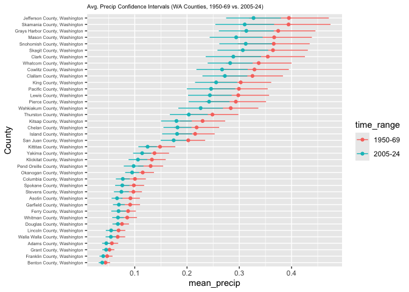
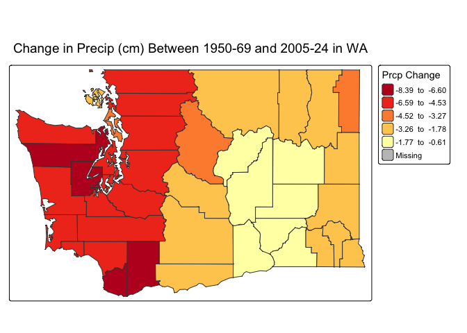

Geog 4/6300: Lab 3-Confidence intervals
================

## Confidence intervals

**Your name: Grayson Smith**

**Overview:**

In this lab, we will create confidence intervals for January
precipitation in Washington during two time periods: 1950-1969 and
2005-2024. Using county-level precipitation data from the ERA5 dataset,
you will estimate statewide precipitation patterns, then examine
variation and change at the county level. We’ve summed the precipitation
in January for each county over two twenty year time periods: 1950-1969
and 2005-2024. You’ll be using those data to create confidence intervals
at a state and county level.

To load these data, load the csv file, which is included in the data
folder:

``` r
era5_data<-read_csv("data/precip_uswest_era5.csv")
```

This is a long format dataset including county identifiers, county
population, median household income, and poverty rate. Census figures
are based on the 2018-22 ACS. The last two columns (year, prcp_m,
time_range) give the year and total precipitation in meters from the
ERA5 NetCDF file, and two time ranges (1950-1969 and 2005-2024).

The script used to create this dataframe is also provided in this
repository (‘lab3_dataprep’), along with rasters of the yearly mean
total precipitation for Januaries in the two time periods of interest.

For this lab to be marked complete, it must demonstrate the following
learning standards:

- 11. Create effective data visualizations across multiple chart types
      (line, scatter, histogram, Q-Q plot), applying appropriate
      aesthetic choices such as color, grouping, and labeling. (Tasks 2
      and 5)
- 12. Produce and interpret confidence interval plots that enable visual
      comparison of means and uncertainty across groups or time periods.
      (Tasks 2, 3, 5, and 6)
- 13. Visualize spatial data using appropriate mapping tools, selecting
      suitable classification schemes and cartographic elements to
      support clear communication. (Task 7)
- 14. Arrange and present tabular results in a readable format
      appropriate for a technical document or report. (Tasks 1 and 4)
- 15. Use measures of central tendency and dispersion to describe the
      variables in tabular datasets (Tasks 1 and 4)
- 20. Explaining how evidence from a sample supports conclusions about a
      population while acknowledging sampling variability and
      uncertainty. (Tasks 3 and 6)
- 22. Construct and interpret confidence intervals, explaining how
      factors such as sample size and spatial scale affect the precision
      of an estimate. (Tasks 1, 3, 4 and 6)

# Part 1: Calculating statewide confidence intervals for Washington’s precipitation

In the first part of this lab, you’ll determine a confidence interval
for Washington’s precipitation for these two time periods. This can be
helpful in identifying whether precipitation has changed across the
state (e.g., whether the two confidence intervals overlap) using the
county data as your sample.

**Task 1** *Load the data and filter it to just include data for the
state of Washington. Then create a table showing mean precipitation,
standard deviation, number of observations (sample size), and
upper/lower confidence interval bounds for each of the two time periods
in the `time_range` field. Use `kable` to display the table when you are
done.*

``` r
era5_data_filtered <- era5_data %>%
  filter(st_name == "Washington") %>%
  group_by(time_range, st_name) %>%
  summarize(mean_precip = mean(prcp_m),
            sd_precip_meters = sd(prcp_m),
            num_obs = n(), #Do not include any var name here
            se_precip_meters = sd_precip_meters/sqrt(num_obs))
```

    ## `summarise()` has regrouped the output.
    ## ℹ Summaries were computed grouped by time_range and st_name.
    ## ℹ Output is grouped by time_range.
    ## ℹ Use `summarise(.groups = "drop_last")` to silence this message.
    ## ℹ Use `summarise(.by = c(time_range, st_name))` for per-operation grouping
    ##   (`?dplyr::dplyr_by`) instead.

``` r
#Getting the necessary z-score:
z.score_upper_95 = qnorm(0.975)

era5_data_filtered_CI <- era5_data_filtered %>%
  mutate(error = z.score_upper_95 * se_precip_meters,
         ci_upper = mean_precip + error,
         ci_lower = mean_precip - error)

kable(era5_data_filtered_CI)
```

| time_range | st_name | mean_precip | sd_precip_meters | num_obs | se_precip_meters | error | ci_upper | ci_lower |
|:---|:---|---:|---:|---:|---:|---:|---:|---:|
| 1950-69 | Washington | 0.2032239 | 0.1562948 | 780 | 0.0055963 | 0.0109685 | 0.2141923 | 0.1922554 |
| 2005-24 | Washington | 0.1664626 | 0.1230138 | 780 | 0.0044046 | 0.0086329 | 0.1750955 | 0.1578298 |

Using the code provided in class, create a ggplot graphic that
visualizes these two confidence intervals. You’ll want to use
`geom_point` and `geom_linerange` to do so. Use states as the y-axis and
mean precipitation as the x axis. Vary the color and position of the
dots and lines for the mean/CI by the `time_range` variable. Feel free
to also experiment with axis labels/themes to make the graph more
appealing and accessible.

**Task 2** *Create a ggplot graphic as described above to show the
confidence intervals for precipitation in Washington for each time
range.*

``` r
ggplot(era5_data_filtered_CI %>% mutate(State=reorder(st_name,mean_precip)))+
  geom_linerange(aes(xmin=ci_lower,xmax=ci_upper,y=time_range,group=time_range, color = time_range)) +
  geom_point(aes(x=mean_precip, y=time_range, color=time_range)) +
  labs(title="Avg. Precip (m) Confidence Intervals (WA, 1950-69 vs. 2005-24)") +
  theme(plot.title = element_text(size=9))
```

<!-- -->

**Task 3** *Interpret your table and graph. What do they tell us about
the change in Washington’s precipitation during this time?*

Both the table and the graph seem to indicate that precipitation has
quite notably decreased between the periods studied here (i.e. 1950-69
and 2005-24). The table demonstrates that the mean precip decreased by
0.037 meters on average between these two periods – roughly 1.457 inches
– and the CIs graphed above indicate that this difference is
statistically significant (as the CIs do not intersect). This indicates
to me that there is a meaningful decrease in precip in Washington as a
whole that is not explainable by chance. It will be interesting to
examine this relationship on the county level in the tasks below – and
to look into potential physical causes of this precip decrease
(potentially including climate change-enhanced effects).

# Part 2: Analyzing county data in Washington.

In part 1, you ran a state level analysis. What if you wanted to
identify where populations might be negatively affected by precipitation
changes within a state? In this section, you’ll look at the changes in
precipitation **at county level** in Washington to

To start with, adapt your code from step 1 so that you create confidence
intervals for **counties** instead of states. After creating that
dataset, create another ggplot graph of those confidence intervals that
you can compare to the state level data in Task 2 to examine how
precipitation has changed across counties in Washington.

**Task 4** *Create a summary table for January precipitation in
Washington counties for both time periods. Use the same approach as in
Task 1, but calculate statistics for counties rather than the state as a
whole. Call the head of your table with `kable` when you are done.*

``` r
era5_data_filtered_cty <- era5_data %>%
  filter(st_name == "Washington") %>%
  group_by(time_range,cty_name) %>%
  summarize(mean_precip = mean(prcp_m),
            sd_precip_meters = sd(prcp_m),
            num_obs = n(), #Do not include any var name here
            se_precip_meters = sd_precip_meters/sqrt(num_obs))
```

    ## `summarise()` has regrouped the output.
    ## ℹ Summaries were computed grouped by time_range and cty_name.
    ## ℹ Output is grouped by time_range.
    ## ℹ Use `summarise(.groups = "drop_last")` to silence this message.
    ## ℹ Use `summarise(.by = c(time_range, cty_name))` for per-operation grouping
    ##   (`?dplyr::dplyr_by`) instead.

``` r
#Getting the necessary z-score:
z.score_upper_95 = qnorm(0.975)

era5_data_filtered_CI_cty <- era5_data_filtered_cty %>%
  mutate(error = z.score_upper_95 * se_precip_meters,
         ci_upper_cty = mean_precip + error,
         ci_lower_cty = mean_precip - error)

kable(head(era5_data_filtered_CI_cty))
```

| time_range | cty_name | mean_precip | sd_precip_meters | num_obs | se_precip_meters | error | ci_upper_cty | ci_lower_cty |
|:---|:---|---:|---:|---:|---:|---:|---:|---:|
| 1950-69 | Adams County, Washington | 0.0561916 | 0.0275746 | 20 | 0.0061659 | 0.0120849 | 0.0682765 | 0.0441067 |
| 1950-69 | Asotin County, Washington | 0.0917109 | 0.0412774 | 20 | 0.0092299 | 0.0180903 | 0.1098012 | 0.0736206 |
| 1950-69 | Benton County, Washington | 0.0439175 | 0.0199657 | 20 | 0.0044645 | 0.0087502 | 0.0526677 | 0.0351673 |
| 1950-69 | Chelan County, Washington | 0.2184237 | 0.0983827 | 20 | 0.0219991 | 0.0431173 | 0.2615410 | 0.1753063 |
| 1950-69 | Clallam County, Washington | 0.3252100 | 0.1331571 | 20 | 0.0297748 | 0.0583576 | 0.3835676 | 0.2668524 |
| 1950-69 | Clark County, Washington | 0.3545254 | 0.1621728 | 20 | 0.0362629 | 0.0710741 | 0.4255995 | 0.2834514 |

**Task 5** *Visualize the confidence intervals for the county-level data
you generated in task 4, using the same style as you did for Task 2
above. For an optional extra challenge, visually highlight the counties
where the confidence intervals between time periods do NOT overlap.*

``` r
ggplot(era5_data_filtered_CI_cty %>% mutate(County=reorder(cty_name,mean_precip))) +
  geom_linerange(aes(xmin=ci_lower_cty,xmax=ci_upper_cty,y=County,group=time_range, color = time_range)) +
  geom_point(aes(x=mean_precip, y=County, color=time_range)) +
  labs(title="Avg. Precip Confidence Intervals (WA Counties, 1950-69 vs. 2005-24)") +
  theme(plot.title = element_text(size=7)) + 
  theme(axis.text.y = element_text(size=5.5))
```

<!-- -->

``` r
#NOTE: Try to find a way to highlight non-overlapping counties (if there are any)
```

**Task 6**: *Compare the size of the error terms for your county level
data to the error terms at state level that you calculated in Task 1.
Are they bigger or smaller? Explain why the formula you used for
calculating the error terms produced error terms of different sizes. How
is this difference visible in your ggplot graphs?*

The errors tended to (in the vast majority of cases) grow for the
county-level data compared to the state-level data. This is likely
because there much less observations for each individual county than
there is for the state overall. In turn, this smaller n results in a
larger number for standard error (since n is in the denominator of the
standard error function), which then leads to a larger error in general
(assuming the standard deviation is roughly similar throughout). This is
demonstrated clearly in the size of the error bars for the county- and
state-level data, with the confidence intervals for the state-level data
spanning only roughly 0.02 m and many of the confidence intervals for
the couny level data (with some exceptions) spanning a much larger range
(some as much as nearly 0.2 meters).

**Task 7**: *Transform the county data from task 4 into wide format so
that the means for each time period are in the same row for each county.
Then calculate the change in precipitation between the time periods.
Join this table to the geopackage file that contains county boundaries
and census data, making sure that you only have Washington counties
included - use the geopackage `data/acsdata_cty_westreg.gpkg`. Then use
`tmap` to map out the difference in precipitation means across the two
time periods. Make sure the legend of this map is interpretable.*

``` r
# Reading in the spatial data
WA_cty_census_data <- st_read('data/acsdata_cty_westreg.gpkg') %>%
  filter(st_name == "Washington")
```

    ## Reading layer `acsdata_cty_westreg' from data source 
    ##   `/Users/graysonsmith/DataScience_General/lab3_geog4300_cant_beat_auburn/data/acsdata_cty_westreg.gpkg' 
    ##   using driver `GPKG'
    ## Simple feature collection with 414 features and 8 fields
    ## Geometry type: MULTIPOLYGON
    ## Dimension:     XY
    ## Bounding box:  xmin: -124.7322 ymin: 31.33223 xmax: -102.0416 ymax: 49.00237
    ## Geodetic CRS:  WGS 84

``` r
# Making the era5 df wider
era5_data_filtered_cty_wider <- era5_data_filtered_cty %>%
  select(cty_name, time_range, mean_precip) %>%
  pivot_wider(id_cols = cty_name, names_from = time_range, values_from = mean_precip)

# Altering the era5 data to include the precip difference
era5_data_filtered_cty_wider <- era5_data_filtered_cty_wider %>%
  mutate(change_precip_in_cm = round(((era5_data_filtered_cty_wider$`2005-24` - era5_data_filtered_cty_wider$`1950-69`) * 100), digits = 2))
# Trying the spatial join
era5_acs_joined <- era5_data_filtered_cty_wider %>%
  left_join(WA_cty_census_data, by='cty_name') %>%
  st_as_sf()

# Trying to make the plot
tm_shape(era5_acs_joined) +
  tm_polygons(fill = "change_precip_in_cm", palette = "-YlOrRd", title = "Prcp Change", style = "jenks", legend.format = list(text.separator = " to ")) +
  tm_title("Change in Precip (cm) Between 1950-69 and 2005-24 in WA")
```

    ## 

    ## ── tmap v3 code detected ───────────────────────────────────────────────────────

    ## [v3->v4] `tm_polygons()`: instead of `style = "jenks"`, use fill.scale =
    ## `tm_scale_intervals()`.
    ## ℹ Migrate the argument(s) 'style', 'palette' (rename to 'values'),
    ##   'legend.format' (rename to 'label.format') to 'tm_scale_intervals(<HERE>)'
    ## [v3->v4] `tm_polygons()`: migrate the argument(s) related to the legend of the
    ## map variable `fill` namely 'title', 'legend.format' (rename to 'format') to
    ## 'fill.legend = tm_legend(<HERE>)'
    ## Multiple palettes called "yl_or_rd" found: "brewer.yl_or_rd", "matplotlib.yl_or_rd". The first one, "brewer.yl_or_rd", is returned.
    ## 
    ## [cols4all] color palettes: use palettes from the R package cols4all. Run
    ## `cols4all::c4a_gui()` to explore them. The old palette name "-YlOrRd" is named
    ## "yl_or_rd" (in long format "brewer.yl_or_rd")

<!-- -->

# Optional challenge section: Interpreting the implications of precipitation changes

Now that you’ve calculated these means and confidence intervals, let’s
identify who might be most affected by changes in precipitation. To see
who is affected, create a dummy variable that flags any counties with a
decline of 5 centimeters or more (0.05 meters) with a 1, labeling all
other counties with a 0. Use group_by and summarise to do the following:

- Count the total population in each of these two county groups.
- Calculate the mean value for median income and poverty rate in these
  two groups.

**Task 8** *Create a dummy variable for counties with a change of 0.05
meters or more between the time periods. Calculate how many people
currently live in these counties along with the mean value of median
income (medinc) and poverty rate (pov_pop_pct) for those areas.*

**Task 9** *Create a one paragraph summary of your results from tasks 7
and 8. What do you learn about how precipitation has changed in the last
70 years across the state of Washington? How would you describe the
population affected by large drops in precipitation based on your
results?*

{Your response here.}

Small multiples or multi-panel maps are often a helpful way to show
change over time. See this page for more information about how these are
created in `tmap`:

- <https://r-tmap.github.io/tmap/articles/basics_facets>

Using these tools, create a small multiples map of your precipitation
data for counties in a state of your choice for all 40 years in these
two time periods. This means you will have one figure with 40 individual
maps, all of the same state in different years. These maps should allow
easy comparison across years and should be clearly labeled so that they
could be interpreted by someone with no knowledge of this assignment.

In addition, describe two interesting trends you see in the figure you
created.

{Your response here.}

# Final submission stuff

**Disclosure of assistance:** Besides class materials, what other
sources of assistance did you use while completing this lab? These can
include input from classmates, relevant material identified through web
searches (e.g., Stack Overflow), or assistance from ChatGPT or other AI
tools. How did these sources support your own learning in completing
this lab?

The primary two resources I used for this lab were conversations with
classmates and limited usage of AI (still primarily Google Gemini,
although ChatGPT was also consulted as well, given that our discussions
indicate that Gemini might not be the most skilled at coding
applications). In terms of classmate conversations, these primarily took
place with Will, and mostly centered around discussing our qualitative
answers (especially for Task 6) and in making aesthetic changes to task
7 (as we collaborated on ways to make the graphic more visually
appealing and interpretable, including via the use of a better-looking
color scale and the use of the seperator “to” in the legend instead of
the less-clear “-” \[given the data were already negative\]). In terms
of AI usage, this again focused on learning and applying concepts that I
did not understand from class. In this case, AI use was less than in
previous labs due to a continually growing familiarity with data
wrangling and visualization skills. Nevertheless, I did still consult AI
tools (and Will) on topics of graphical aesthetics – like on alterations
to make Task 7 more visually useful – as those are still skills I need
to learn with more confidence and effectiveness. In all, I thought that
my need for outside assistance was less on this lab than on previous
ones; however, I certainly still have much to learn in our future work.

**Lab reflection:** How do you feel about the work you did on this lab?
Was it easy, moderate, or hard? What are the biggest things you learned
by completing it?

I thought that this lab was somewhere between easy and moderately
difficult, as it focused on skills that we had (mostly) practiced
extensively (like the data wrangling/manipulation and graphical
visualizations); however, there were certainly still many things to
learn and grow in through this assignment. Specifically, I learned more
about how to create confidence intervals in R – including a conceptual
understanding of the equations thereof – and I learned the syntax of how
to create these new ggplot graphics. Beyond that, I also continued to
become more proficient at data wrangling and manipulation via the
additional application provided in this lab, and I continue to learn
more about interpreting the results of code. Overall, I thought this lab
went relatively well – albeit with plenty of room to grow – and should
hopefully continue to be a building block to future improvement in
subsequent assignments.
